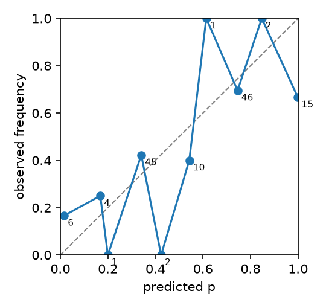

# AMIC results
_Generated by `python -m amic.eval.report`. Every number comes from this repository's data and runs; regenerate rather than edit._
## 1. Dataset and labels

Education set: 40 synthetic learners, 805 probes; split by learner ({'train': 484, 'test': 161, 'val': 160}). Counterfactual label: memory-required iff the best memory-backed answer meets the student's need better than the no-memory answer by >= 1 point (judge `needs_met`, 1-5, mean of 2 judgments; a correct generic reply to a self-contained question is not penalised).

Memory-required: **58.8%** (personalisation-inclusive variant 65.1%). Depth among required: {'SHALLOW': 363, 'DEEP': 110}. Fabricated-history rate of the no-memory answer: 26.2% (SHALLOW 4.0%, DEEP 2.4%).

| category          |   n | required   | personal   |
|:------------------|----:|:-----------|:-----------|
| explicit_recall   | 160 | 88.1%      | 91.2%      |
| general_covered   | 121 | 27.3%      | 38.8%      |
| general_new       | 124 | 34.7%      | 44.4%      |
| implicit_personal | 160 | 70.0%      | 75.0%      |
| lexical_trap      |  80 | 47.5%      | 56.2%      |
| m0_followup       |  80 | 50.0%      | 56.2%      |
| personalize       |  80 | 82.5%      | 82.5%      |

Human vs judge labels (n=98): agreement 63.3%, Cohen's kappa **0.263**. The judge marks memory as required more often than the human annotator (59% vs 51% on the same probes). For reference, kappa human vs the generator's intended category = 0.349; judge vs intended (all 805 probes) = 0.417. Label validity is therefore moderate at best and bounds every downstream metric.

## 2. Decision quality (offline replay, education TEST split)

lambda = 4 (tau* = 0.20); n = 161 probes from held-out learners. `cost` = expected cost per query in units of one false retrieve (a false skip costs lambda). `savings_captured` = share of the always->oracle retrieval reduction achieved.

| policy                       | retrieval_rate   | recall   | false_skip_rate   | precision   |    f1 |   cost | savings_captured   | share_tier0   | share_tier1   | share_failopen   | depth_acc   |
|:-----------------------------|:-----------------|:---------|:------------------|:------------|------:|-------:|:-------------------|:--------------|:--------------|:-----------------|:------------|
| never                        | 0.0%             | 0.0%     | 100.0%            | 0.0%        | 0     |  2.236 |                    | 0.0%          | 0.0%          | 0.0%             |             |
| always                       | 100.0%           | 100.0%   | 0.0%              | 55.9%       | 0.717 |  0.441 |                    | 0.0%          | 0.0%          | 0.0%             | 22.2%       |
| oracle                       | 55.9%            | 100.0%   | 0.0%              | 100.0%      | 1     |  0     |                    | 0.0%          | 0.0%          | 0.0%             | 100.0%      |
| amic (T0+T1, band->SHALLOW)  | 92.5%            | 94.4%    | 5.6%              | 57.0%       | 0.711 |  0.522 | 16.9%              | 18.0%         | 51.6%         | 30.4%            | 64.7%       |
| amic, hard tau (no band)     | 90.1%            | 93.3%    | 6.7%              | 57.9%       | 0.715 |  0.528 | 22.5%              | 18.0%         | 82.0%         | 0.0%             | 65.5%       |
| ablation: Tier 0 only        | 96.3%            | 95.6%    | 4.4%              | 55.5%       | 0.702 |  0.528 | 8.5%               | 18.0%         | 0.0%          | 82.0%            | 65.1%       |
| ablation: no S3 sketch probe | 91.9%            | 94.4%    | 5.6%              | 57.4%       | 0.714 |  0.516 | 18.3%              | 18.0%         | 60.2%         | 21.7%            | 65.9%       |
| ablation: tau fixed 0.5      | 60.9%            | 72.2%    | 27.8%             | 66.3%       | 0.691 |  0.826 | 88.7%              | 18.0%         | 74.5%         | 7.5%             | 58.5%       |
| variant: LightGBM Tier 1     | 95.7%            | 95.6%    | 4.4%              | 55.8%       | 0.705 |  0.522 | 9.9%               | 18.0%         | 48.4%         | 33.5%            | 65.1%       |

### LoCoMo (external check, n = 347; Tier 1 trained on the education set only)

Category 5 (adversarial) is used as a weak memory-not-required analogue; reported separately and never pooled with the education results.

| policy                       | retrieval_rate   | recall   | false_skip_rate   | precision   |   cost |
|:-----------------------------|:-----------------|:---------|:------------------|:------------|-------:|
| never                        | 0.0%             | 0.0%     | 100.0%            | 0.0%        |  3.112 |
| always                       | 100.0%           | 100.0%   | 0.0%              | 77.8%       |  0.222 |
| oracle                       | 77.8%            | 100.0%   | 0.0%              | 100.0%      |  0     |
| amic (T0+T1, band->SHALLOW)  | 100.0%           | 100.0%   | 0.0%              | 77.8%       |  0.222 |
| amic, hard tau (no band)     | 100.0%           | 100.0%   | 0.0%              | 77.8%       |  0.222 |
| ablation: Tier 0 only        | 100.0%           | 100.0%   | 0.0%              | 77.8%       |  0.222 |
| ablation: no S3 sketch probe | 100.0%           | 100.0%   | 0.0%              | 77.8%       |  0.222 |
| ablation: tau fixed 0.5      | 100.0%           | 100.0%   | 0.0%              | 77.8%       |  0.222 |
| variant: LightGBM Tier 1     | 100.0%           | 100.0%   | 0.0%              | 77.8%       |  0.222 |

## 3. Cost-sensitive thresholding: lambda sweep (test split)

Same calibrated Tier-1 model; only the threshold rule changes. Lower cost is better.

|   lambda | tau          |   tau_value | retrieval_rate   | false_skip_rate   |   cost |
|---------:|:-------------|------------:|:-----------------|:------------------|-------:|
|        1 | 1/(1+lambda) |       0.5   | 60.9%            | 27.8%             |  0.36  |
|        1 | 0.5 (argmax) |       0.5   | 60.9%            | 27.8%             |  0.36  |
|        2 | 1/(1+lambda) |       0.333 | 89.4%            | 6.7%              |  0.447 |
|        2 | 0.5 (argmax) |       0.5   | 60.9%            | 27.8%             |  0.516 |
|        4 | 1/(1+lambda) |       0.2   | 92.5%            | 5.6%              |  0.522 |
|        4 | 0.5 (argmax) |       0.5   | 60.9%            | 27.8%             |  0.826 |
|        8 | 1/(1+lambda) |       0.111 | 93.2%            | 5.6%              |  0.652 |
|        8 | 0.5 (argmax) |       0.5   | 60.9%            | 27.8%             |  1.447 |
|       16 | 1/(1+lambda) |       0.059 | 96.3%            | 4.4%              |  0.826 |
|       16 | 0.5 (argmax) |       0.5   | 60.9%            | 27.8%             |  2.689 |

## 4. Tier-1 calibration (test split, rows Tier 0 abstains on)

| model       |   n_test |   auc |   brier |   ece |
|:------------|---------:|------:|--------:|------:|
| tier1       |      132 | 0.671 |   0.237 | 0.116 |
| tier1_no_s3 |      132 | 0.708 |   0.23  | 0.137 |
| tier1_lgbm  |      132 | 0.682 |   0.221 | 0.039 |

Largest standardized LogReg coefficients: `s4_concept_hits` -0.62, `s2_m0_turns` -0.54, `x_affinity_personal` +0.43, `s2_n_sessions_log` -0.43, `s2_n_memories_log` +0.27, `x_general_no_personal` -0.26, `s1_deixis` +0.21, `s1_possessive` -0.19

## 5. Efficiency (live runs, test split, all seeds)

Milliseconds. `gate` = signals + Tier 0 + Tier 1 (excludes the query embedding, which `always` pays too). Tutor calls are served from a prompt-keyed cache when an identical prompt+seed was already generated; cached entries keep their first-run prefill/decode timings, and `total` adds those back in place of the ~0 ms cache lookup.

| arm       |   n | retrieval_rate   |   prompt_tokens |   memory_tokens |   embed_p50 |   gate_p50 |   gate_p95 |   retrieval_p50 |   prefill_mean |   total_p50 |   total_p95 |   mem_tok_saved_vs_always |   mem_prefill_uncached_est |
|:----------|----:|:-----------------|----------------:|----------------:|------------:|-----------:|-----------:|----------------:|---------------:|------------:|------------:|--------------------------:|---------------------------:|
| always    | 483 | 100.0%           |           906.8 |           800   |         7.8 |        0   |        0   |             3.1 |           70.4 |      2691.7 |      5409.7 |                       0   |                      238.9 |
| amic      | 483 | 92.5%            |           489.7 |           368.7 |         6.8 |        2.1 |        3.3 |             2.7 |           61.1 |      2584.4 |      4539.1 |                     431.3 |                      110.1 |
| amic_lam1 | 483 | 60.9%            |           389.2 |           268.7 |         8.3 |        3   |        3.4 |             2.4 |           49   |      2588.8 |      4359   |                     531.3 |                       80.2 |
| never     | 483 | 0.0%             |           125.6 |             0   |         0   |        0   |        0   |             0   |           28.2 |      2717.9 |      4480.2 |                     800   |                        0   |
| oracle    | 483 | 55.9%            |           359.8 |           239   |         6.6 |        0   |        0   |             2.3 |           47.8 |      2571.6 |      4353.5 |                     561   |                       71.4 |

**Prefill caveat.** Measured prefill is nearly flat across arms (the `always` arm sends ~6x the prompt tokens of `never` at similar prefill) because Ollama reuses cached prompt prefixes: each synthetic learner has only a handful of history records, so DEEP retrieval returns an almost identical memory block on every query from that learner. Real deployments with larger, more varied memories would cache less. `mem_prefill_uncached_est` = memory tokens x 0.299 ms/token, the uncached prefill rate measured by the Day-1 probe (nonce-first prompts, `runs/probe.json`). Token counts are unaffected by caching and are the primary efficiency metric.

## 6. Break-even inequality (measured)

C_emb cancels (both arms embed the query once; plan R1). Tier 2 and escalation are out of scope, so P(T2) = P(esc) = 0. Savings are per query against `always` on the same probes and seeds. See the prefill caveat in section 5.

### amic

| term                                               |    value |
|:---------------------------------------------------|---------:|
| C_feat (signals, excl. embedding)                  |   0.3451 |
| C_T0                                               |   0.0049 |
| P(T1)                                              |   0.8199 |
| C_T1 (when fired)                                  |   2.176  |
| P(T2), P(esc)                                      |   0      |
| r (retrieval rate)                                 |   0.9255 |
| memory tokens saved / query (vs always)            | 431.311  |
| store ms saved / query                             |   0.6072 |
| prefill ms saved / query (measured, prompt-cached) |   9.3732 |
| LHS: gate overhead per query (ms)                  |   2.1341 |
| RHS measured: store + prefill saved (ms)           |   9.9803 |
| RHS uncached estimate: store + tokens x rate (ms)  | 129.427  |

**`amic`: measured: 2.134 ms overhead vs 10.0 ms saved (holds); uncached estimate: 129.4 ms saved (holds).** End-to-end p50 total 2584 ms vs always 2692 ms; mean prompt tokens 490 vs 907.

### amic_lam1

| term                                               |    value |
|:---------------------------------------------------|---------:|
| C_feat (signals, excl. embedding)                  |   0.3874 |
| C_T0                                               |   0.0053 |
| P(T1)                                              |   0.8199 |
| C_T1 (when fired)                                  |   2.5214 |
| P(T2), P(esc)                                      |   0      |
| r (retrieval rate)                                 |   0.6087 |
| memory tokens saved / query (vs always)            | 531.298  |
| store ms saved / query                             |   1.4491 |
| prefill ms saved / query (measured, prompt-cached) |  21.4398 |
| LHS: gate overhead per query (ms)                  |   2.4599 |
| RHS measured: store + prefill saved (ms)           |  22.8889 |
| RHS uncached estimate: store + tokens x rate (ms)  | 160.133  |

**`amic_lam1`: measured: 2.460 ms overhead vs 22.9 ms saved (holds); uncached estimate: 160.1 ms saved (holds).** End-to-end p50 total 2589 ms vs always 2692 ms; mean prompt tokens 389 vs 907.

## 7. Response quality: pairwise LLM judge vs `always` (test split)

Mean ± sd across tutor sampling seeds (T = 0.7). Identical answers count as ties without a judge call. Fabrication rates are over judged (non-identical) pairs.

| run       |   n |   seeds | win          | tie          | loss         | identical_to_always   | fabricated (run)   | fabricated (always)   |
|:----------|----:|--------:|:-------------|:-------------|:-------------|:----------------------|:-------------------|:----------------------|
| amic      | 483 |       3 | 34.8% ± 2.7% | 23.6% ± 1.2% | 41.6% ± 1.9% | 16.4%                 | 6.9%               | 5.4%                  |
| amic_lam1 | 483 |       3 | 27.3% ± 3.5% | 25.9% ± 2.5% | 46.8% ± 3.1% | 16.4%                 | 12.6%              | 5.0%                  |
| never     | 483 |       3 | 15.1% ± 3.2% | 6.8% ± 1.1%  | 78.1% ± 4.2% | 0.0%                  | 28.8%              | 2.9%                  |
| oracle    | 483 |       3 | 30.0% ± 1.6% | 21.5% ± 0.4% | 48.4% ± 1.2% | 12.6%                 | 10.9%              | 5.0%                  |

### By the route each run chose (all seeds pooled)

`always` routes every query DEEP, so a DEEP choice reproduces its answer (tie). The SHALLOW and SKIP rows are where the runs differ from `always`.

| run       | route chosen   |   n | win   | tie    | loss   | identical_to_always   |
|:----------|:---------------|----:|:------|:-------|:-------|:----------------------|
| amic      | DEEP           |  78 | 0.0%  | 100.0% | 0.0%   | 100.0%                |
| amic      | SHALLOW        | 369 | 44.2% | 8.7%   | 47.2%  | 0.3%                  |
| amic      | SKIP           |  36 | 13.9% | 11.1%  | 75.0%  | 0.0%                  |
| amic_lam1 | DEEP           |  78 | 0.0%  | 100.0% | 0.0%   | 100.0%                |
| amic_lam1 | SHALLOW        | 216 | 44.9% | 10.6%  | 44.4%  | 0.5%                  |
| amic_lam1 | SKIP           | 189 | 18.5% | 12.7%  | 68.8%  | 0.0%                  |
| never     | SKIP           | 483 | 15.1% | 6.8%   | 78.1%  | 0.0%                  |
| oracle    | DEEP           |  60 | 0.0%  | 100.0% | 0.0%   | 100.0%                |
| oracle    | SHALLOW        | 210 | 48.6% | 9.5%   | 41.9%  | 0.5%                  |
| oracle    | SKIP           | 213 | 20.2% | 11.3%  | 68.5%  | 0.0%                  |
