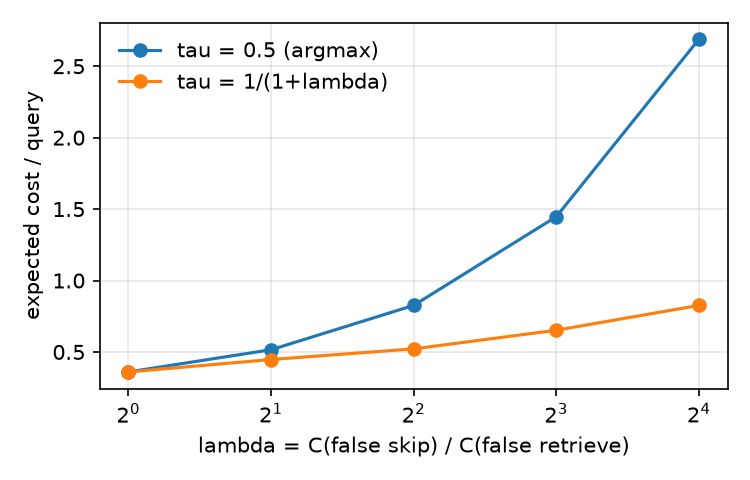

# AMIC results
_Generated by `python -m amic.eval.report`. Every number comes from this repository's data and runs; regenerate rather than edit._
## 1. Dataset and labels

Education set: 40 synthetic learners, 805 probes; split by learner ({'train': 484, 'test': 161, 'val': 160}). Counterfactual label: memory-required iff the best memory-backed answer meets the student's need better than the no-memory answer by >= 1 point (judge `needs_met`, 1-5, mean of 2 judgments; a correct generic reply to a self-contained question is not penalised).

Memory-required: **58.8%** (personalisation-inclusive variant 65.1%). Depth among required: {'SHALLOW': 363, 'DEEP': 110}. Fabricated-history rate of the no-memory answer: 26.2% (SHALLOW 4.0%, DEEP 2.4%).

| category          |   n | required   | personal   |
|:------------------|----:|:-----------|:-----------|
| explicit_recall   | 160 | 88.1%      | 91.2%      |
| general_covered   | 121 | 27.3%      | 38.8%      |
| general_new       | 124 | 34.7%      | 44.4%      |
| implicit_personal | 160 | 70.0%      | 75.0%      |
| lexical_trap      |  80 | 47.5%      | 56.2%      |
| m0_followup       |  80 | 50.0%      | 56.2%      |
| personalize       |  80 | 82.5%      | 82.5%      |

Human vs judge labels (n=98): agreement 63.3%, Cohen's kappa **0.263** (95% CI 0.080 to 0.349, bootstrap over probes). The judge marks memory as required more often than the human annotator (59% vs 51% on the same probes). For reference, kappa human vs the generator's intended category = 0.349; judge vs intended (all 805 probes) = 0.417. Label validity is therefore moderate at best and bounds every downstream metric.

## 2. Decision quality (offline replay, education TEST split)

lambda = 4 (tau* = 0.20); n = 161 probes from held-out learners. `cost` = expected cost per query in units of one false retrieve (a false skip costs lambda). `cost_vs_always` = the policy's cost minus `always`'s on the same probes, with a 95% CI clustered by learner (positive = worse than retrieving every time). `savings_captured` = share of the always->oracle retrieval reduction achieved. 95% CIs are percentile bootstraps that resample whole clusters (fixed seed). The test split has only 8 learners, so learner-clustered intervals are approximate and probably too narrow.

| policy                       | retrieval_rate   | recall   | false_skip_rate   | precision   |    f1 |   cost | cost_vs_always          | savings_captured   | share_tier0   | share_tier1   | share_failopen   | depth_acc   |
|:-----------------------------|:-----------------|:---------|:------------------|:------------|------:|-------:|:------------------------|:-------------------|:--------------|:--------------|:-----------------|:------------|
| never                        | 0.0%             | 0.0%     | 100.0%            | 0.0%        | 0     |  2.236 | +1.795 [+1.438, +2.148] |                    | 0.0%          | 0.0%          | 0.0%             |             |
| always                       | 100.0%           | 100.0%   | 0.0%              | 55.9%       | 0.717 |  0.441 | +0.000 [+0.000, +0.000] |                    | 0.0%          | 0.0%          | 0.0%             | 22.2%       |
| oracle                       | 55.9%            | 100.0%   | 0.0%              | 100.0%      | 1     |  0     | -0.441 [-0.512, -0.370] |                    | 0.0%          | 0.0%          | 0.0%             | 100.0%      |
| amic (T0+T1, band->SHALLOW)  | 92.5%            | 94.4%    | 5.6%              | 57.0%       | 0.711 |  0.522 | +0.081 [-0.025, +0.198] | 16.9%              | 18.0%         | 51.6%         | 30.4%            | 64.7%       |
| amic, hard tau (no band)     | 90.1%            | 93.3%    | 6.7%              | 57.9%       | 0.715 |  0.528 | +0.087 [-0.025, +0.211] | 22.5%              | 18.0%         | 82.0%         | 0.0%             | 65.5%       |
| ablation: Tier 0 only        | 96.3%            | 95.6%    | 4.4%              | 55.5%       | 0.702 |  0.528 | +0.087 [-0.006, +0.194] | 8.5%               | 18.0%         | 0.0%          | 82.0%            | 65.1%       |
| ablation: no S3 sketch probe | 91.9%            | 94.4%    | 5.6%              | 57.4%       | 0.714 |  0.516 | +0.075 [-0.031, +0.190] | 18.3%              | 18.0%         | 60.2%         | 21.7%            | 65.9%       |
| ablation: tau fixed 0.5      | 60.9%            | 72.2%    | 27.8%             | 66.3%       | 0.691 |  0.826 | +0.385 [+0.069, +0.699] | 88.7%              | 18.0%         | 74.5%         | 7.5%             | 58.5%       |
| variant: LightGBM Tier 1     | 95.7%            | 95.6%    | 4.4%              | 55.8%       | 0.705 |  0.522 | +0.081 [-0.019, +0.194] | 9.9%               | 18.0%         | 48.4%         | 33.5%            | 65.1%       |

### LoCoMo (external check, n = 347; Tier 1 trained on the education set only)

Category 5 (adversarial) is used as a weak memory-not-required analogue; reported separately and never pooled with the education results.

| policy                       | retrieval_rate   | recall   | false_skip_rate   | precision   |   cost | cost_vs_always          |
|:-----------------------------|:-----------------|:---------|:------------------|:------------|-------:|:------------------------|
| never                        | 0.0%             | 0.0%     | 100.0%            | 0.0%        |  3.112 | +2.890 [+2.829, +2.945] |
| always                       | 100.0%           | 100.0%   | 0.0%              | 77.8%       |  0.222 | +0.000 [+0.000, +0.000] |
| oracle                       | 77.8%            | 100.0%   | 0.0%              | 100.0%      |  0     | -0.222 [-0.234, -0.211] |
| amic (T0+T1, band->SHALLOW)  | 100.0%           | 100.0%   | 0.0%              | 77.8%       |  0.222 | +0.000 [+0.000, +0.000] |
| amic, hard tau (no band)     | 100.0%           | 100.0%   | 0.0%              | 77.8%       |  0.222 | +0.000 [+0.000, +0.000] |
| ablation: Tier 0 only        | 100.0%           | 100.0%   | 0.0%              | 77.8%       |  0.222 | +0.000 [+0.000, +0.000] |
| ablation: no S3 sketch probe | 100.0%           | 100.0%   | 0.0%              | 77.8%       |  0.222 | +0.000 [+0.000, +0.000] |
| ablation: tau fixed 0.5      | 100.0%           | 100.0%   | 0.0%              | 77.8%       |  0.222 | +0.000 [+0.000, +0.000] |
| variant: LightGBM Tier 1     | 100.0%           | 100.0%   | 0.0%              | 77.8%       |  0.222 | +0.000 [+0.000, +0.000] |

## 3. Cost-sensitive thresholding: lambda sweep (test split)

Same calibrated Tier-1 model; only the threshold rule changes. Lower cost is better.

|   lambda | tau          |   tau_value | retrieval_rate   | false_skip_rate   |   cost |
|---------:|:-------------|------------:|:-----------------|:------------------|-------:|
|        1 | 1/(1+lambda) |       0.5   | 60.9%            | 27.8%             |  0.36  |
|        1 | 0.5 (argmax) |       0.5   | 60.9%            | 27.8%             |  0.36  |
|        2 | 1/(1+lambda) |       0.333 | 89.4%            | 6.7%              |  0.447 |
|        2 | 0.5 (argmax) |       0.5   | 60.9%            | 27.8%             |  0.516 |
|        4 | 1/(1+lambda) |       0.2   | 92.5%            | 5.6%              |  0.522 |
|        4 | 0.5 (argmax) |       0.5   | 60.9%            | 27.8%             |  0.826 |
|        8 | 1/(1+lambda) |       0.111 | 93.2%            | 5.6%              |  0.652 |
|        8 | 0.5 (argmax) |       0.5   | 60.9%            | 27.8%             |  1.447 |
|       16 | 1/(1+lambda) |       0.059 | 96.3%            | 4.4%              |  0.826 |
|       16 | 0.5 (argmax) |       0.5   | 60.9%            | 27.8%             |  2.689 |

## 4. Tier-1 calibration (test split, rows Tier 0 abstains on)

| model       |   n_test |   auc | auc_95ci_learner   |   brier |   ece |
|:------------|---------:|------:|:-------------------|--------:|------:|
| tier1       |      132 | 0.671 | [0.589, 0.757]     |   0.237 | 0.116 |
| tier1_no_s3 |      132 | 0.708 | [0.632, 0.803]     |   0.23  | 0.137 |
| tier1_lgbm  |      132 | 0.682 | [0.585, 0.778]     |   0.221 | 0.039 |

AUC with the S3 sketch probe minus without it: -0.037 (95% CI -0.088 to +0.019, clustered by learner).

Largest standardized LogReg coefficients: `s4_concept_hits` -0.62, `s2_m0_turns` -0.54, `x_affinity_personal` +0.43, `s2_n_sessions_log` -0.43, `s2_n_memories_log` +0.27, `x_general_no_personal` -0.26, `s1_deixis` +0.21, `s1_possessive` -0.19

## 5. Efficiency (live runs, test split, all seeds)

Milliseconds. `gate` = signals + Tier 0 + Tier 1 (excludes the query embedding, which `always` pays too). Tutor calls are served from a prompt-keyed cache when an identical prompt+seed was already generated; cached entries keep their first-run prefill/decode timings, and `total` adds those back in place of the ~0 ms cache lookup.

| arm            |   n | retrieval_rate   |   prompt_tokens |   memory_tokens |   embed_p50 |   gate_p50 |   gate_p95 |   retrieval_p50 |   prefill_mean |   total_p50 |   total_p95 |   mem_tok_saved_vs_always |   mem_prefill_uncached_est |
|:---------------|----:|:-----------------|----------------:|----------------:|------------:|-----------:|-----------:|----------------:|---------------:|------------:|------------:|--------------------------:|---------------------------:|
| always         | 483 | 100.0%           |           906.8 |           800   |         7.8 |        0   |        0   |             3.1 |           70.4 |      2691.7 |      5409.7 |                       0   |                      238.9 |
| always_shallow | 483 | 100.0%           |           437.5 |           314   |         5.9 |        0   |        0   |             2.5 |           64.9 |      2556   |      4580   |                     486   |                       93.8 |
| amic           | 483 | 92.5%            |           489.7 |           368.7 |         6.8 |        2.1 |        3.3 |             2.7 |           61.1 |      2584.4 |      4539.1 |                     431.3 |                      110.1 |
| amic_esc       | 483 | 93.2%            |           492.1 |           370.3 |         7.9 |        2.8 |        3.4 |             2.9 |           61.1 |      2602.6 |      4665.1 |                     429.7 |                      110.6 |
| amic_full      | 483 | 91.9%            |           490.8 |           370.2 |         6   |        2   |      249.8 |             2.8 |           61.4 |      2578.8 |      4523.2 |                     429.8 |                      110.6 |
| amic_lam1      | 483 | 60.9%            |           389.2 |           268.7 |         8.3 |        3   |        3.4 |             2.4 |           49   |      2588.8 |      4359   |                     531.3 |                       80.2 |
| amic_lam1_esc  | 483 | 67.9%            |           419.1 |           289.8 |         8.1 |        2.3 |        3.4 |             2.8 |           49   |      2711.5 |      5430.1 |                     510.2 |                       86.5 |
| amic_no_s3     | 483 | 91.9%            |           489.8 |           369.1 |         5.6 |        1.7 |        2.1 |             2.3 |           60   |      2579.1 |      4490.8 |                     430.9 |                      110.2 |
| never          | 483 | 0.0%             |           125.6 |             0   |         0   |        0   |        0   |             0   |           28.2 |      2717.9 |      4480.2 |                     800   |                        0   |
| never_esc      | 483 | 25.9%            |           237.6 |            80.6 |         0   |        0   |        0   |             0   |           28.2 |      3236   |      6220.7 |                     719.3 |                       24.1 |
| oracle         | 483 | 55.9%            |           359.8 |           239   |         6.6 |        0   |        0   |             2.3 |           47.8 |      2571.6 |      4353.5 |                     561   |                       71.4 |

**Prefill caveat.** Measured prefill is nearly flat across arms (the `always` arm sends ~6x the prompt tokens of `never` at similar prefill) because Ollama reuses cached prompt prefixes: each synthetic learner has only a handful of history records, so DEEP retrieval returns an almost identical memory block on every query from that learner. Real deployments with larger, more varied memories would cache less. `mem_prefill_uncached_est` = memory tokens x 0.299 ms/token, the uncached prefill rate measured by the Day-1 probe (nonce-first prompts, `runs/probe.json`). Token counts are unaffected by caching and are the primary efficiency metric.

## 6. Break-even inequality (measured)

C_emb cancels (both arms embed the query once; plan R1). Every overhead term is measured from the traces: terms paid on only some queries (Tier 2, verification, escalation) are averaged over all queries, i.e. P(term) x C(term). An escalation's retry (retrieval + regeneration) counts in full on the overhead side. Savings are per query against `always` on the same probes and seeds. See the prefill caveat in section 5.

### amic

| term                                                    |    value |
|:--------------------------------------------------------|---------:|
| C_feat (signals, excl. embedding)                       |   0.3451 |
| C_T0                                                    |   0.0049 |
| P(T1)                                                   |   0.8199 |
| C_T1 (when fired)                                       |   2.176  |
| P(T2) x C_T2 (Tier-2 ms per query)                      |   0      |
| decision-cache ms per query                             |   0      |
| verify ms per query (P(SKIP) x C_ver)                   |   0      |
| P(esc)                                                  |   0      |
| P(esc) x (C_ret + C_gen) (escalation ms per query)      |   0      |
| r (retrieval rate, escalations included)                |   0.9255 |
| memory tokens saved / query (vs always)                 | 431.311  |
| store ms saved / query                                  |   0.6072 |
| prefill ms saved / query (measured, prompt-cached)      |   9.3732 |
| LHS: gate + verify + escalation overhead per query (ms) |   2.1341 |
| RHS measured: store + prefill saved (ms)                |   9.9803 |
| RHS uncached estimate: store + tokens x rate (ms)       | 129.427  |

**`amic`: measured: 2.134 ms overhead vs 10.0 ms saved (holds); uncached estimate: 129.4 ms saved (holds).** End-to-end p50 total 2584 ms vs always 2692 ms; mean prompt tokens 490 vs 907.

### amic_esc

| term                                                    |    value |
|:--------------------------------------------------------|---------:|
| C_feat (signals, excl. embedding)                       |   0.3759 |
| C_T0                                                    |   0.0048 |
| P(T1)                                                   |   0.8199 |
| C_T1 (when fired)                                       |   2.3781 |
| P(T2) x C_T2 (Tier-2 ms per query)                      |   0      |
| decision-cache ms per query                             |   0      |
| verify ms per query (P(SKIP) x C_ver)                   |  28.0488 |
| P(esc)                                                  |   0.0062 |
| P(esc) x (C_ret + C_gen) (escalation ms per query)      |  18.0191 |
| r (retrieval rate, escalations included)                |   0.9317 |
| memory tokens saved / query (vs always)                 | 429.658  |
| store ms saved / query                                  |   0.4081 |
| prefill ms saved / query (measured, prompt-cached)      |   9.3732 |
| LHS: gate + verify + escalation overhead per query (ms) |  48.3983 |
| RHS measured: store + prefill saved (ms)                |   9.7812 |
| RHS uncached estimate: store + tokens x rate (ms)       | 128.735  |

**`amic_esc`: measured: 48.398 ms overhead vs 9.8 ms saved (does NOT hold); uncached estimate: 128.7 ms saved (holds).** End-to-end p50 total 2603 ms vs always 2692 ms; mean prompt tokens 492 vs 907.

### amic_full

| term                                                    |    value |
|:--------------------------------------------------------|---------:|
| C_feat (signals, excl. embedding)                       |   0.3109 |
| C_T0                                                    |   0.0044 |
| P(T1)                                                   |   0.8199 |
| C_T1 (when fired)                                       |   1.8727 |
| P(T2) x C_T2 (Tier-2 ms per query)                      |  25.2012 |
| decision-cache ms per query                             |   0      |
| verify ms per query (P(SKIP) x C_ver)                   |   0      |
| P(esc)                                                  |   0      |
| P(esc) x (C_ret + C_gen) (escalation ms per query)      |   0      |
| r (retrieval rate, escalations included)                |   0.9193 |
| memory tokens saved / query (vs always)                 | 429.752  |
| store ms saved / query                                  |   0.4818 |
| prefill ms saved / query (measured, prompt-cached)      |   9.0191 |
| LHS: gate + verify + escalation overhead per query (ms) |  27.0519 |
| RHS measured: store + prefill saved (ms)                |   9.5008 |
| RHS uncached estimate: store + tokens x rate (ms)       | 128.836  |

**`amic_full`: measured: 27.052 ms overhead vs 9.5 ms saved (does NOT hold); uncached estimate: 128.8 ms saved (holds).** End-to-end p50 total 2579 ms vs always 2692 ms; mean prompt tokens 491 vs 907.

### amic_lam1

| term                                                    |    value |
|:--------------------------------------------------------|---------:|
| C_feat (signals, excl. embedding)                       |   0.3874 |
| C_T0                                                    |   0.0053 |
| P(T1)                                                   |   0.8199 |
| C_T1 (when fired)                                       |   2.5214 |
| P(T2) x C_T2 (Tier-2 ms per query)                      |   0      |
| decision-cache ms per query                             |   0      |
| verify ms per query (P(SKIP) x C_ver)                   |   0      |
| P(esc)                                                  |   0      |
| P(esc) x (C_ret + C_gen) (escalation ms per query)      |   0      |
| r (retrieval rate, escalations included)                |   0.6087 |
| memory tokens saved / query (vs always)                 | 531.298  |
| store ms saved / query                                  |   1.4491 |
| prefill ms saved / query (measured, prompt-cached)      |  21.4398 |
| LHS: gate + verify + escalation overhead per query (ms) |   2.4599 |
| RHS measured: store + prefill saved (ms)                |  22.8889 |
| RHS uncached estimate: store + tokens x rate (ms)       | 160.133  |

**`amic_lam1`: measured: 2.460 ms overhead vs 22.9 ms saved (holds); uncached estimate: 160.1 ms saved (holds).** End-to-end p50 total 2589 ms vs always 2692 ms; mean prompt tokens 389 vs 907.

### amic_lam1_esc

| term                                                    |    value |
|:--------------------------------------------------------|---------:|
| C_feat (signals, excl. embedding)                       |   0.3792 |
| C_T0                                                    |   0.0054 |
| P(T1)                                                   |   0.8199 |
| C_T1 (when fired)                                       |   2.362  |
| P(T2) x C_T2 (Tier-2 ms per query)                      |   0      |
| decision-cache ms per query                             |   0      |
| verify ms per query (P(SKIP) x C_ver)                   |  86.1792 |
| P(esc)                                                  |   0.0704 |
| P(esc) x (C_ret + C_gen) (escalation ms per query)      | 203.767  |
| r (retrieval rate, escalations included)                |   0.6791 |
| memory tokens saved / query (vs always)                 | 510.203  |
| store ms saved / query                                  |   1.2013 |
| prefill ms saved / query (measured, prompt-cached)      |  21.4398 |
| LHS: gate + verify + escalation overhead per query (ms) | 292.267  |
| RHS measured: store + prefill saved (ms)                |  22.6412 |
| RHS uncached estimate: store + tokens x rate (ms)       | 153.584  |

**`amic_lam1_esc`: measured: 292.267 ms overhead vs 22.6 ms saved (does NOT hold); uncached estimate: 153.6 ms saved (does NOT hold).** End-to-end p50 total 2711 ms vs always 2692 ms; mean prompt tokens 419 vs 907.

### amic_no_s3

| term                                                    |    value |
|:--------------------------------------------------------|---------:|
| C_feat (signals, excl. embedding)                       |   0.1717 |
| C_T0                                                    |   0.0042 |
| P(T1)                                                   |   0.8199 |
| C_T1 (when fired)                                       |   1.6934 |
| P(T2) x C_T2 (Tier-2 ms per query)                      |   0      |
| decision-cache ms per query                             |   0      |
| verify ms per query (P(SKIP) x C_ver)                   |   0      |
| P(esc)                                                  |   0      |
| P(esc) x (C_ret + C_gen) (escalation ms per query)      |   0      |
| r (retrieval rate, escalations included)                |   0.9193 |
| memory tokens saved / query (vs always)                 | 430.851  |
| store ms saved / query                                  |   0.9635 |
| prefill ms saved / query (measured, prompt-cached)      |  10.4462 |
| LHS: gate + verify + escalation overhead per query (ms) |   1.5643 |
| RHS measured: store + prefill saved (ms)                |  11.4097 |
| RHS uncached estimate: store + tokens x rate (ms)       | 129.646  |

**`amic_no_s3`: measured: 1.564 ms overhead vs 11.4 ms saved (holds); uncached estimate: 129.6 ms saved (holds).** End-to-end p50 total 2579 ms vs always 2692 ms; mean prompt tokens 490 vs 907.

### never_esc

| term                                                    |    value |
|:--------------------------------------------------------|---------:|
| C_feat (signals, excl. embedding)                       |   0      |
| C_T0                                                    |   0      |
| P(T1)                                                   |   0      |
| C_T1 (when fired)                                       |   0      |
| P(T2) x C_T2 (Tier-2 ms per query)                      |   0      |
| decision-cache ms per query                             |   0      |
| verify ms per query (P(SKIP) x C_ver)                   | 228.947  |
| P(esc)                                                  |   0.2588 |
| P(esc) x (C_ret + C_gen) (escalation ms per query)      | 578.259  |
| r (retrieval rate, escalations included)                |   0.2588 |
| memory tokens saved / query (vs always)                 | 719.327  |
| store ms saved / query                                  |   3.1313 |
| prefill ms saved / query (measured, prompt-cached)      |  42.2785 |
| LHS: gate + verify + escalation overhead per query (ms) | 807.206  |
| RHS measured: store + prefill saved (ms)                |  45.4097 |
| RHS uncached estimate: store + tokens x rate (ms)       | 217.974  |

**`never_esc`: measured: 807.206 ms overhead vs 45.4 ms saved (does NOT hold); uncached estimate: 218.0 ms saved (does NOT hold).** End-to-end p50 total 3236 ms vs always 2692 ms; mean prompt tokens 238 vs 907.

## 7. Response quality: pairwise LLM judge vs `always` (test split)

Mean ± sd across tutor sampling seeds (T = 0.7). Identical answers count as ties without a judge call. Fabrication rates are over judged (non-identical) pairs. `net` = win rate minus loss rate (all seeds pooled) with 95% CIs clustered by probe (the 3 seeds of a probe move together) and by learner. 95% CIs are percentile bootstraps that resample whole clusters (fixed seed). The test split has only 8 learners, so learner-clustered intervals are approximate and probably too narrow.

| run            |   n |   seeds | win          | tie          | loss         | net (95% CI, probe)     | net (95% CI, learner)   | identical_to_always   | fabricated (run)   | fabricated (always)   |
|:---------------|----:|--------:|:-------------|:-------------|:-------------|:------------------------|:------------------------|:----------------------|:-------------------|:----------------------|
| always_shallow | 483 |       3 | 42.7% ± 3.4% | 10.4% ± 2.9% | 47.0% ± 2.4% | -4.3% [-13.3%, +4.6%]   | -4.3% [-11.7%, +3.1%]   | 0.2%                  | 8.3%               | 7.3%                  |
| amic           | 483 |       3 | 34.8% ± 2.7% | 23.6% ± 1.2% | 41.6% ± 1.9% | -6.8% [-15.3%, +1.4%]   | -6.8% [-14.6%, +1.2%]   | 16.4%                 | 6.9%               | 5.4%                  |
| amic_esc       | 483 |       3 | 35.0% ± 2.9% | 23.4% ± 1.6% | 41.6% ± 1.9% | -6.6% [-15.1%, +1.7%]   | -6.6% [-14.6%, +1.5%]   | 16.4%                 | 6.7%               | 5.4%                  |
| amic_full      | 483 |       3 | 34.4% ± 3.4% | 24.4% ± 1.6% | 41.2% ± 2.2% | -6.8% [-15.3%, +1.4%]   | -6.8% [-14.4%, +0.8%]   | 17.0%                 | 7.0%               | 5.5%                  |
| amic_lam1      | 483 |       3 | 27.3% ± 3.5% | 25.9% ± 2.5% | 46.8% ± 3.1% | -19.5% [-28.2%, -11.0%] | -19.5% [-26.3%, -12.7%] | 16.4%                 | 12.6%              | 5.0%                  |
| amic_lam1_esc  | 483 |       3 | 29.6% ± 3.4% | 25.7% ± 2.2% | 44.7% ± 2.7% | -15.1% [-23.6%, -6.6%]  | -15.1% [-21.3%, -9.4%]  | 16.4%                 | 7.2%               | 5.4%                  |
| amic_no_s3     | 483 |       3 | 34.0% ± 4.0% | 24.4% ± 4.0% | 41.6% ± 0.0% | -7.7% [-15.7%, +0.4%]   | -7.7% [-12.3%, -2.5%]   | 17.0%                 | 8.7%               | 5.7%                  |
| never          | 483 |       3 | 15.1% ± 3.2% | 6.8% ± 1.1%  | 78.1% ± 4.2% | -62.9% [-70.0%, -55.9%] | -62.9% [-67.5%, -58.0%] | 0.0%                  | 28.8%              | 2.9%                  |
| never_esc      | 483 |       3 | 24.0% ± 2.9% | 7.9% ± 0.4%  | 68.1% ± 2.6% | -44.1% [-52.6%, -35.6%] | -44.1% [-54.2%, -34.6%] | 0.2%                  | 13.3%              | 4.6%                  |
| oracle         | 483 |       3 | 30.0% ± 1.6% | 21.5% ± 0.4% | 48.4% ± 1.2% | -18.4% [-27.3%, -9.7%]  | -18.4% [-28.5%, -8.9%]  | 12.6%                 | 10.9%              | 5.0%                  |

### Paired comparisons (same probes and seeds)

`diff` = net win of the first run minus net win of the second, on the (probe, seed) pairs both runs answered. A difference counts as real only when BOTH its probe- and learner-clustered CIs exclude 0 (decision rule fixed before the extension runs; docs/PLAN.md).

| comparison                |   pairs | diff (95% CI, probe)    | diff (95% CI, learner)   | both CIs exclude 0   |
|:--------------------------|--------:|:------------------------|:-------------------------|:---------------------|
| amic − always_shallow     |     483 | -2.5% [-10.4%, +5.0%]   | -2.5% [-9.3%, +5.0%]     | no                   |
| amic − amic_no_s3         |     483 | +0.8% [-5.4%, +7.0%]    | +0.8% [-4.6%, +6.9%]     | no                   |
| amic_lam1 − amic          |     483 | -12.6% [-20.7%, -4.8%]  | -12.6% [-20.5%, -3.1%]   | yes                  |
| oracle − amic             |     483 | -11.6% [-21.3%, -1.4%]  | -11.6% [-22.5%, -3.7%]   | yes                  |
| amic_esc − amic           |     483 | +0.2% [+0.0%, +0.6%]    | +0.2% [+0.0%, +0.6%]     | no                   |
| amic_lam1_esc − amic_lam1 |     483 | +4.3% [+1.4%, +7.5%]    | +4.3% [+1.4%, +7.6%]     | yes                  |
| never_esc − never         |     483 | +18.8% [+12.6%, +25.5%] | +18.8% [+11.2%, +27.7%]  | yes                  |
| amic_esc − never_esc      |     483 | +37.5% [+27.5%, +47.0%] | +37.5% [+27.1%, +47.3%]  | yes                  |
| amic_full − amic          |     483 | +0.0% [-1.2%, +1.2%]    | +0.0% [-0.6%, +0.6%]     | no                   |

### By the route each run chose (all seeds pooled)

`always` routes every query DEEP, so a DEEP choice reproduces its answer (tie). The SHALLOW and SKIP rows are where the runs differ from `always`.

| run            | route chosen   |   n | win   | tie    | loss   | identical_to_always   |
|:---------------|:---------------|----:|:------|:-------|:-------|:----------------------|
| always_shallow | SHALLOW        | 483 | 42.7% | 10.4%  | 47.0%  | 0.2%                  |
| amic           | DEEP           |  78 | 0.0%  | 100.0% | 0.0%   | 100.0%                |
| amic           | SHALLOW        | 369 | 44.2% | 8.7%   | 47.2%  | 0.3%                  |
| amic           | SKIP           |  36 | 13.9% | 11.1%  | 75.0%  | 0.0%                  |
| amic_esc       | DEEP           |  78 | 0.0%  | 100.0% | 0.0%   | 100.0%                |
| amic_esc       | SHALLOW        | 369 | 44.2% | 8.7%   | 47.2%  | 0.3%                  |
| amic_esc       | SKIP           |  36 | 16.7% | 8.3%   | 75.0%  | 0.0%                  |
| amic_full      | DEEP           |  81 | 0.0%  | 100.0% | 0.0%   | 100.0%                |
| amic_full      | SHALLOW        | 363 | 43.3% | 9.1%   | 47.7%  | 0.3%                  |
| amic_full      | SKIP           |  39 | 23.1% | 10.3%  | 66.7%  | 0.0%                  |
| amic_lam1      | DEEP           |  78 | 0.0%  | 100.0% | 0.0%   | 100.0%                |
| amic_lam1      | SHALLOW        | 216 | 44.9% | 10.6%  | 44.4%  | 0.5%                  |
| amic_lam1      | SKIP           | 189 | 18.5% | 12.7%  | 68.8%  | 0.0%                  |
| amic_lam1_esc  | DEEP           |  78 | 0.0%  | 100.0% | 0.0%   | 100.0%                |
| amic_lam1_esc  | SHALLOW        | 216 | 44.9% | 10.6%  | 44.4%  | 0.5%                  |
| amic_lam1_esc  | SKIP           | 189 | 24.3% | 12.2%  | 63.5%  | 0.0%                  |
| amic_no_s3     | DEEP           |  81 | 0.0%  | 100.0% | 0.0%   | 100.0%                |
| amic_no_s3     | SHALLOW        | 363 | 43.0% | 8.8%   | 48.2%  | 0.3%                  |
| amic_no_s3     | SKIP           |  39 | 20.5% | 12.8%  | 66.7%  | 0.0%                  |
| never          | SKIP           | 483 | 15.1% | 6.8%   | 78.1%  | 0.0%                  |
| never_esc      | SKIP           | 483 | 24.0% | 7.9%   | 68.1%  | 0.2%                  |
| oracle         | DEEP           |  60 | 0.0%  | 100.0% | 0.0%   | 100.0%                |
| oracle         | SHALLOW        | 210 | 48.6% | 9.5%   | 41.9%  | 0.5%                  |
| oracle         | SKIP           | 213 | 20.2% | 11.3%  | 68.5%  | 0.0%                  |

## 8. Summary: memory tokens vs answer quality (live runs, test split)

`net_win_vs_always` = pairwise win rate minus loss rate against `always` (DEEP every turn); 0 = as good as `always`. A run is better than another only if it uses fewer memory tokens **and** has a higher net win rate.

| run            | retrieval_rate   |   memory_tokens | tokens_saved_vs_always   | net_win_vs_always   | net_win_95ci_learner   |
|:---------------|:-----------------|----------------:|:-------------------------|:--------------------|:-----------------------|
| always         | 100.0%           |             800 | 0.0%                     | 0.0%                |                        |
| amic_esc       | 93.2%            |             370 | 53.7%                    | -6.6%               | [-14.6%, +1.5%]        |
| amic_full      | 91.9%            |             370 | 53.7%                    | -6.8%               | [-14.4%, +0.8%]        |
| amic_no_s3     | 91.9%            |             369 | 53.9%                    | -7.7%               | [-12.3%, -2.5%]        |
| amic           | 92.5%            |             369 | 53.9%                    | -6.8%               | [-14.6%, +1.2%]        |
| always_shallow | 100.0%           |             314 | 60.7%                    | -4.3%               | [-11.7%, +3.1%]        |
| amic_lam1_esc  | 67.9%            |             290 | 63.8%                    | -15.1%              | [-21.3%, -9.4%]        |
| amic_lam1      | 60.9%            |             269 | 66.4%                    | -19.5%              | [-26.3%, -12.7%]       |
| oracle         | 55.9%            |             239 | 70.1%                    | -18.4%              | [-28.5%, -8.9%]        |
| never_esc      | 25.9%            |              81 | 89.9%                    | -44.1%              | [-54.2%, -34.6%]       |
| never          | 0.0%             |               0 | 100.0%                   | -62.9%              | [-67.5%, -58.0%]       |

## 9. Verify-and-escalate (extension; pre-registered E1-E4)

Answers generated without memory (SKIP) are checked by the ResponseVerifier (lexical patterns for invented history or deferral, then the LLM verifier); a failed check retries ONCE with SHALLOW memory. Escalated answers are byte-identical to the always-SHALLOW answer for the same probe and seed (same prompt and seed; generation cache), and identical answer pairs reuse the earlier pairwise verdict (docs/PLAN.md section 9), so differences against the base run come only from the escalated rows. 95% CIs are percentile bootstraps that resample whole clusters (fixed seed). The test split has only 8 learners, so learner-clustered intervals are approximate and probably too narrow.

### Live runs

| run           |   n | skip_rate   | escalation_rate   | escalated_of_skips   | esc_precision_vs_label   | esc_recall_vs_label   |   memory_tokens |   verify_ms_p50 (SKIPs) |   retry_ms_p50 | net_vs_always (95% CI, learner)   | diff vs base (learner CI)          |
|:--------------|----:|:------------|:------------------|:---------------------|:-------------------------|:----------------------|----------------:|------------------------:|---------------:|:----------------------------------|:-----------------------------------|
| amic_esc      | 483 | 7.5%        | 0.6%              | 8.3%                 | 100.0%                   | 20.0%                 |             370 |                   237.8 |         2505.3 | -6.6% [-14.6%, +1.5%]             | vs amic: +0.2% [+0.0%, +0.6%]      |
| amic_lam1_esc | 483 | 39.1%       | 7.0%              | 18.0%                | 44.1%                    | 20.0%                 |             290 |                   240   |         2801.7 | -15.1% [-21.3%, -9.4%]            | vs amic_lam1: +4.3% [+1.4%, +7.6%] |
| never_esc     | 483 | 100.0%      | 25.9%             | 25.9%                | 72.8%                    | 33.7%                 |              81 |                   235.7 |         2180.5 | -44.1% [-54.2%, -34.6%]           | vs never: +18.8% [+11.2%, +27.7%]  |

### Verifier mode (offline replay of the same answers, E4)

| base run   | verifier   | escalation_rate   | net_vs_always           | gain vs base (probe CI)   | gain vs base (learner CI)   |
|:-----------|:-----------|:------------------|:------------------------|:--------------------------|:----------------------------|
| amic       | lexical    | 0.2%              | -6.8% [-14.6%, +1.2%]   | +0.0% [+0.0%, +0.0%]      | +0.0% [+0.0%, +0.0%]        |
| amic       | llm        | 0.4%              | -6.6% [-14.6%, +1.5%]   | +0.2% [+0.0%, +0.6%]      | +0.2% [+0.0%, +0.6%]        |
| amic       | both       | 0.6%              | -6.6% [-14.6%, +1.5%]   | +0.2% [+0.0%, +0.6%]      | +0.2% [+0.0%, +0.6%]        |
| amic_lam1  | lexical    | 3.9%              | -16.8% [-23.7%, -10.6%] | +2.7% [+0.4%, +5.2%]      | +2.7% [+0.6%, +5.2%]        |
| amic_lam1  | llm        | 4.1%              | -16.1% [-22.2%, -10.6%] | +3.3% [+1.2%, +6.2%]      | +3.3% [+1.2%, +5.3%]        |
| amic_lam1  | both       | 7.0%              | -15.1% [-21.3%, -9.4%]  | +4.3% [+1.4%, +7.5%]      | +4.3% [+1.4%, +7.6%]        |
| never      | lexical    | 10.1%             | -56.1% [-62.5%, -50.0%] | +6.8% [+3.3%, +10.6%]     | +6.8% [+2.9%, +11.7%]       |
| never      | llm        | 20.5%             | -45.5% [-55.3%, -35.8%] | +17.4% [+11.8%, +23.4%]   | +17.4% [+10.9%, +25.0%]     |
| never      | both       | 25.7%             | -44.5% [-54.5%, -34.8%] | +18.4% [+12.2%, +25.1%]   | +18.4% [+11.0%, +27.0%]     |

Judge self-consistency: 557 identical answer pairs were judged twice by different runs (independent A/B order); the two verdicts agree on 72.5%. This is the noise floor of a single pairwise judgment.

## 10. Tier 2: LLM adjudicator in the uncertain band (extension; pre-registered T1)

Band [0.000, 0.270] around tau* = 0.20, from `configs/ablations/full.yaml` (sized on the validation split by `scripts/tune_band.py` to the widest band holding at most 12% of traffic: isotonic calibration leaves only a few distinct p values, so the band holds less). Tier 2 = `llama3.1:8b` (the brief's 3B model cannot stay resident next to the tutor on the 8 GB GPU), constrained JSON, 800 ms timeout and 12% traffic cap, both failing open to SHALLOW. Verdicts were recorded once per probe (`scripts/replay_tier2.py`) and replayed. Test split, lambda = 4.

| policy                                        | retrieval_rate   | false_skip_rate   |   cost | cost_vs_always (learner CI)   | share_tier2   | share_failopen   |
|:----------------------------------------------|:-----------------|:------------------|-------:|:------------------------------|:--------------|:-----------------|
| full cascade (Tier 2 in the band)             | 91.9%            | 5.6%              |  0.516 | +0.075 [-0.019, +0.186]       | 6.2%          | 0.6%             |
| same band, fail open to SHALLOW (no Tier 2)   | 96.3%            | 4.4%              |  0.528 | +0.087 [-0.006, +0.194]       | 0.0%          | 6.8%             |
| hard tau (no band)                            | 90.1%            | 6.7%              |  0.528 | +0.087 [-0.025, +0.211]       | 0.0%          | 0.0%             |
| amic as run (T0+T1, original band -> SHALLOW) | 92.5%            | 5.6%              |  0.522 | +0.081 [-0.025, +0.198]       | 0.0%          | 30.4%            |

Full cascade minus the same band failing open (cost per query, learner CI): -0.012 [-0.081, +0.049]. Tier 2 decided 11 test probes; of those, Tier 2 retrieved on 36% and the label says memory was required on 18%. Verdict latency (val + test, n = 266): p50 285 ms, p95 308 ms; 0.0% would exceed the timeout; routes {'SKIP': 0.762, 'SHALLOW': 0.238}.
